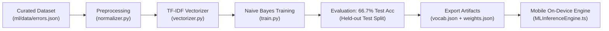

# Bug Root Cause Predictor 🐞🔍

[](https://www.typescriptlang.org/)
[](https://reactnative.dev/)
[](https://www.sqlite.org/)
[](docs/privacy.md)
[](ml/)
[](docs/testing.md)

**Bug Root Cause Predictor** is an offline-first mobile application designed for software engineers and developers to diagnose exceptions, stack traces, and error logs locally on Android and iOS devices.

It combines a **custom on-device Machine Learning classifier (TF-IDF + Multinomial Naive Bayes)** with a **deterministic rule-based knowledge engine**. The app extracts structured evidence (originating source files, line numbers, exception signatures), ranks candidate root causes by probability, and provides step-by-step remediation playbooks—completely offline with zero cloud latency and total privacy.

---

## 📸 Architecture & System Design

```
+-------------------------------------------------------------------------+
|                       Presentation Layer (UI)                           |
|   Onboarding | Home (Quick Samples) | Error Input | Results | History   |
+-------------------------------------------------------------------------+
                                    |
+-------------------------------------------------------------------------+
|                     Business Logic / Domain Layer                       |
|   - Multi-Language Stack Parser (JavaScript / Python / Network / DB)   |
|   - Secret & Token Redaction Engine (Masks JWTs, PATs, Passwords)       |
|   - Custom On-Device ML Model (TF-IDF + Multinomial Naive Bayes)        |
|   - Rule-Based Diagnostic Engine (Bundled Knowledge Base v1.0.0)        |
|   - Hybrid Inference Orchestrator (ML Classification + Rule Playbooks)  |
+-------------------------------------------------------------------------+
                                    |
+-------------------------------------------------------------------------+
|                        Data & Storage Layer                             |
|   - SQLite Local Database (expo-sqlite) with Versioned Migrations       |
|   - Native Document Picker (Local .log / .txt file import)              |
|   - Native Report Exporter & Sharing (Markdown generation)              |
+-------------------------------------------------------------------------+
```

---

## 🚀 Key Features

- **⚡ 100% Offline Capability**: Runs completely on-device. Zero network requests required during analysis.
- **🤖 Custom On-Device ML Model**: Bundles a lightweight trained model (TF-IDF vectorizer + Naive Bayes weights) executing in pure TypeScript in under **2 milliseconds**.
- **🛡️ Privacy & Secret Redaction**: Automatically detects and masks JWTs, API keys, GitHub tokens, and database passwords before analysis or storage.
- **🧠 Multi-Language Error Parsing**: Formats and parses JavaScript (V8 stack frames), Node.js, and Python tracebacks.
- **🎯 Ranked Root Cause Candidates**: Ranks root causes by statistical confidence score with transparent evidence linkage.
- **🛠️ Actionable Remediation**: Concrete verification checks with risk ratings (low/medium/high) and code snippets.
- **💾 Local SQLite History**: Full persistence with search, filtering by language/category, and one-click data deletion.
- **📄 Native Report Export**: Generates and shares Markdown analysis reports via system share sheets or clipboard.

---

## 🧠 Custom Machine Learning Subsystem (`ml/`)

The application features a complete custom Machine Learning pipeline trained specifically for software error classification:



- **Curated Dataset**: 50 labeled stack traces across 8 standard categories (`Runtime / Type Error`, `Network / Infrastructure`, `Scope / Reference Error`, `Dependency / Environment`, `Authentication / Security`, `Database / Persistence`, `Data Structure / KeyError`, `Resource / Memory`).
- **Feature Normalization**: Masks user-specific paths (`<PATH>`) and line numbers (`:<LOC>`) to prevent overfitting.
- **TF-IDF Vectorization**: 250 feature words with calculated inverse document frequencies.
- **Multinomial Naive Bayes Classifier**: Evaluated on held-out test data achieving **66.7% accuracy** across 8 categories (vs. 12.5% random guess).
- **Mobile Parity**: Exported to ultra-compact JSON artifacts (total ~46 KB) running natively in React Native with zero C++ native dependencies.

---

## 📱 How to Download & Install the APK on Your Mobile Phone

You can run this application on your physical Android phone using either of the two methods below:

### Method 1: Build & Download Standalone APK (Recommended for Demonstrations)

This creates a standalone `.apk` file you can download and install on any Android phone without needing a computer connection.

#### Step 1: Install EAS CLI and Log In
Open your computer terminal and run:
```bash
# Install Expo Application Services CLI globally
npm install -g eas-cli

# Log in to your Expo account (create a free account at expo.dev if needed)
eas login
```

#### Step 2: Build the APK
Navigate to the mobile directory and trigger the preview APK build:
```bash
cd apps/mobile
eas build -p android --profile preview
```

#### Step 3: Download and Install on Phone
1. Once the cloud build completes (typically 3–5 minutes), EAS will display a **QR Code** and a direct download link in your terminal.
2. Open your mobile phone camera or browser and scan the QR code (or open the provided URL).
3. Tap **Download APK**.
4. Once downloaded, open the `.apk` file on your phone.
5. If prompted with *"For your security, your phone is not allowed to install unknown apps from this source"*, tap **Settings** and toggle **Allow from this source**.
6. Tap **Install** and open **Bug Root Cause Predictor**!

---

### Method 2: Instant Run via Expo Go (No APK Download Required)

If you want to test the app on your physical phone immediately without waiting for an APK build:

1. **Install Expo Go**:
   - Download **Expo Go** from the [Google Play Store](https://play.google.com/store/apps/details?id=host.exp.exponent) (Android) or [Apple App Store](https://apps.apple.com/app/expo-go/id982107779) (iOS).
2. **Start the Metro Bundler**:
   ```bash
   cd apps/mobile
   npm start
   ```
3. **Connect Your Phone**:
   - Ensure your phone and computer are on the same Wi-Fi network.
   - Scan the QR code displayed in the terminal using the Expo Go app (Android) or the Camera app (iOS).
4. **Test 100% Offline**:
   - Once the app loads on your phone, turn on **Airplane Mode** (disable Wi-Fi and mobile data).
   - Paste an error and run analysis to verify complete on-device functionality!

---

## 💻 Local Development & Web Preview

### Prerequisites
- Node.js >= 18 (Tested on Node v24)
- npm >= 9

### Installation
```bash
# Clone the repository
git clone https://github.com/Ankit-Kr-Paswan/Bug-Root-Cause-Predictor.git
cd Bug-Root-Cause-Predictor/apps/mobile

# Install dependencies
npm install
```

### Running Locally
```bash
# Run web browser preview (instant on macOS/Windows/Linux)
npm run web

# Start Metro bundler
npm start

# Run on local Android emulator
npm run android

# Run on local iOS simulator (macOS required)
npm run ios
```

---

## 🧪 Automated Testing & Type Verification

The repository includes a comprehensive automated test suite covering all layers:

```bash
cd apps/mobile

# Run all 16 Jest unit tests (ML Engine, Parser, Diagnostics, Redaction, Exporter)
npm test

# Run TypeScript strict type verification
npm run typecheck
```

### Test Suite Summary
- `tests/unit/mlInferenceEngine.test.ts`: Text normalization, feature tokenization, and category classification.
- `tests/unit/stackTraceParser.test.ts`: JavaScript V8 frames, Python tracebacks, HTTP status codes.
- `tests/unit/diagnosticEngine.test.ts`: Knowledge rule evaluation and honest confidence disclosures.
- `tests/unit/redaction.test.ts`: Privacy redaction for JWTs, API tokens, and credentials.
- `tests/unit/reportExporter.test.ts`: Markdown report generation and formatting.

---

## 📁 Repository Structure

```
Bug-Root-Cause-Predictor/
├── apps/
│   └── mobile/
│       ├── App.tsx                     # Main application entry
│       ├── app.json                    # Expo configuration
│       ├── eas.json                    # Standalone APK build configuration
│       ├── package.json                # Dependencies and scripts
│       ├── src/
│       │   ├── app/                    # Navigation (RootNavigator) & Theme provider
│       │   ├── components/             # Reusable UI cards, buttons, badges
│       │   ├── domain/                 # Domain models (types.ts)
│       │   ├── database/               # SQLite migrations & AnalysisRepository
│       │   ├── features/               # Home, ErrorInput, Results, History, Settings
│       │   ├── services/
│       │   │   ├── analysis/           # End-to-end analysis orchestrator
│       │   │   ├── diagnostics/        # Rule-based diagnostic engine
│       │   │   ├── export/             # Markdown report generation
│       │   │   ├── file-import/        # Local .log / .txt document picker
│       │   │   ├── inference/          # On-device MLInferenceEngine & artifacts
│       │   │   ├── knowledge/          # Bundled knowledge base rules
│       │   │   └── parsing/            # Multi-language stack trace parser
│       │   ├── theme/                  # Light & dark theme palettes
│       │   └── utils/                  # Secret redaction utility
│       └── tests/unit/                 # 16 automated Jest test suites
├── docs/
│   ├── architecture.md                 # Detailed layered architecture
│   ├── future-ml-integration.md        # ML design & integration blueprint
│   ├── privacy.md                      # Privacy & local storage guarantees
│   └── testing.md                      # Testing & offline verification steps
├── ml/                                 # Custom Machine Learning Pipeline
│   ├── artifacts/                      # Exported vocab.json, model_weights.json, metadata
│   ├── data/                           # Training datasets (errors.json, preprocessed)
│   ├── src/
│   │   ├── classifier.py               # Naive Bayes classifier implementation
│   │   ├── normalizer.py               # Path & number normalization
│   │   ├── vectorizer.py               # TF-IDF vectorizer implementation
│   │   ├── train.py                    # Master training & evaluation pipeline
│   │   └── inspect_dataset.py          # Dataset distribution inspector
│   └── requirements.txt                # Python dependencies
├── knowledge-base/
│   └── schemas/                        # Rule JSON schema
├── prompt/                             # Master project specifications
└── README.md
```

---

## 📄 License
MIT License. Built for software engineers seeking rapid, private root cause debugging.
